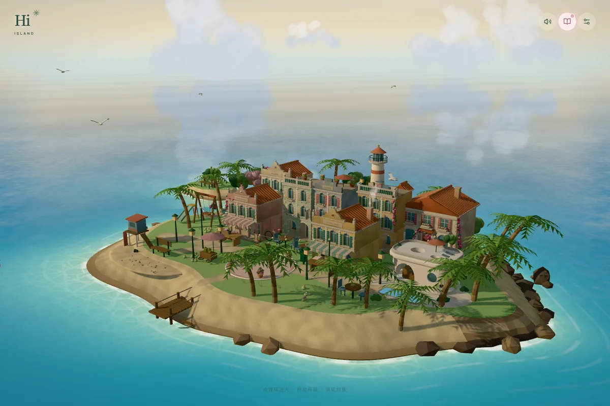

# 小岛一直在这里 · An Island for You



> 小岛一直在。想来的时候，就回来。

一座可以探索、拍照，也可以庆祝任何小事的 3D 小岛。你可以把它改成自己的小世界，或者送给一个人。

**[在线体验](https://island-for-you.vercel.app)** · [本地运行](#本地运行) · **[二创教程](docs/REMIX.md)** · [部署](docs/REMIX.md#部署自己的岛) · [English](#english)

## 岛上有什么

九个地方，没有必须完成的顺序。回家翻照片墙和手账，去花店包花、食堂点菜，在海边看日落，沿山路等天亮；也可以进图书馆，等雨停后回到全岛看彩虹。

想庆祝的时候，去岛心的长桌，写下想庆祝的事。点蜡烛、许愿、吹灭，再把这一刻拍下来。生日、毕业、重逢，或只是今天过得还不错，都可以。

它原本是我送给朋友的生日礼物。这里是可以独立运行的公开版：保留场景和小机关，用七张无人物风景与静物画替换照片，移除了私人信件和专属称呼。

| 操作 | 怎么玩 |
| --- | --- |
| 拖动、滚轮或双指 | 转动和缩放小岛 |
| 点击建筑或手账地图 | 进入一个地点；点「退出场景」回到全岛 |
| 点击场景里的物件 | 包花、点菜、看照片，或发现一个小反应 |
| 拿起相机 | 调整取景框，拍下照片，在手账里查看并保存 |
| 去岛心长桌 | 随时开始一次庆祝，无需集齐回忆 |

## 本地运行

准备 **Git、Node.js 22.12+ 和 npm**。常规运行不需要后端、API Key、Python 或 Blender；模型、字体和示例图片已经在仓库中。

```sh
git clone https://github.com/carpediemzzsssww-cpu/island-for-you.git
cd island-for-you
npm ci
npm run dev
```

打开终端显示的地址，通常是 `http://localhost:5173`。如果你要保存二创到自己的 GitHub，先点仓库右上角 **Fork**，再克隆自己名下的仓库。

```sh
npm test          # 状态逻辑检查
npm run build     # 生成 dist/
npm run preview   # 本地查看构建结果
```

这是一个静态网页项目。探索进度和拍立得保存在当前浏览器中，换设备不会自动同步。部署出去的图片与音乐是公开资源；详细的浏览器检查见 [QA 文档](docs/QA.md)。

## 从哪里开始二创

第一次可以只做三件事：改左上角的名字，换一张天空，写一句自己的欢迎语。它们都不需要重新建模。

| 想改什么 | 从哪里改 | 教程 |
| --- | --- | --- |
| 小岛标识、称呼、场景名 | `src/content.ts` 的 `site`、`places` | [名字和文案](docs/REMIX.md#名字和文案) |
| 欢迎语、按钮、手账文字 | 导出 `文案清单.md`，编辑后写回源码 | [不逐个翻组件也能改文字](docs/REMIX.md#名字和文案) |
| 照片墙、桌面、海边明信片 | `public/photos/` 与 `assets-manifest.json` | [替换图片](docs/REMIX.md#替换图片) |
| 背景音乐和播放顺序 | `src/content.ts` 的 `tracks`、`records` | [替换音乐](docs/REMIX.md#替换音乐) |
| 页面颜色、字体、手机按钮 | `src/style.css`、`src/ui/hud.css` | [颜色和字体](docs/REMIX.md#颜色和字体) |
| 日落、雨天、庆祝的时长 | `src/experience.ts` 的 `TIMING` | [场景和交互](docs/REMIX.md#场景和交互) |
| 店铺招牌、建筑或花型 | `src/world/anchors.json`、模型脚本、`src/bouquet/` | [场景和交互](docs/REMIX.md#场景和交互) |

**[跟着教程做一座自己的岛 →](docs/REMIX.md)**

教程包含可复制的修改示例、图片目录与导入命令、字体依赖、音乐替换、Vercel 部署和常见问题。项目没有可视化搭建后台；改内容主要编辑配置和文字，新增玩法需要修改 React / Three.js 代码。

## 项目结构

技术栈：React 19、TypeScript、Vite 7、Three.js、React Three Fiber、Drei、Zustand。

```text
src/
  content.ts        名字、地点、花材、菜单、曲目
  experience.ts     场景时长与绿光出处
  store.ts          运行状态与本地保存
  ui/               手账、弹窗、相机、场景操作
  world/            3D 场景、镜头、天气、物件与庆祝
  bouquet/          包花工作台和花型
  minitool/         小工具的声音、存储、模型与容器适配
public/             网页直接使用的模型、图片、字体、音乐
assets-manifest.json 图片清单
scripts/            文案导出、素材处理、模型生成和检查
```

3D 部分尽量把静态物件合并绘制；灯光数量保持固定，避免点灯时全场材质重新编译。手机上会按运行情况降低渲染开销；`?lite` 可主动关闭后期效果。修改模型后，仍需要在目标设备上检查画面与流畅度。

## 小红书小工具

同一套公开内容另有离线构建，使用简化模型、合成音乐和容器相册接口，并为顶部导航与底部手势留出空间。

```sh
npm run build:minitool
```

这一步额外需要官方 `minitool-zip-builder` 1.8.0，**普通网页不需要安装它**。获取方法、路径配置与产物说明见 [二创教程](docs/REMIX.md#制作小红书小工具) 和 [小工具说明](docs/MINITOOL.md)。ZIP 输出到 `release/`；平台模拟器及 Android / iOS 真机验证仍需单独完成。

## 一起改进

欢迎提 [Issue](https://github.com/carpediemzzsssww-cpu/island-for-you/issues) 或 [Pull Request](https://github.com/carpediemzzsssww-cpu/island-for-you/pulls)。问题反馈请附：设备与浏览器、进入了哪个场景、操作步骤、预期结果和截图。不要附私人照片、信件或聊天内容。

改文案、改善手机布局、补无障碍说明、修复模型缺件都欢迎。提交前运行 `npm test` 和 `npm run build`；界面改动附上桌面、手机竖屏和横屏截图，玩法改动说明如何复现。大范围改建场景，可以先在 Issue 里聊聊。

## 素材与许可

| 内容 | 二创时注意什么 |
| --- | --- |
| 代码与模型生成脚本 | [MIT](LICENSE)，使用、修改和分发时保留版权与许可声明 |
| 字体 | 源雲明體与 Compagnon，按 [OFL 及字体声明](public/fonts/LICENSES.md) 分发 |
| 示例图片 | 七张 AI 生成的风景与静物画，来源说明见 [ARTWORK](docs/ARTWORK.md)；没有私人参考原图 |
| 网页歌曲录音 | 演示版保留五首歌曲，**不属于 MIT 许可范围**；发布自己的版本前替换成可分发的音频，方法见 [音乐教程](docs/REMIX.md#替换音乐) |
| Draco 解码器 | `public/draco/`，Google，Apache-2.0 |

照片、录像和音乐即使放在静态资源目录里，部署后也能被访问。请只发布你愿意公开、且可以使用的素材。公开版没有私人信件，也没有开启私人版本的隐藏开关。

## English

An explorable 3D island for quiet visits and any celebration. Wrap a bouquet, eat something nice, watch the sunset, visit the library, and save a photo of the moment. It began as a gift for a friend; this standalone public edition removes personal letters and uses seven person-free drawings.

**[Try the island](https://island-for-you.vercel.app)** · **[Remix guide (Chinese)](docs/REMIX.md)**

To run it, clone this repository (or your own fork), install Node.js 22.12+, then run `npm ci` and `npm run dev`. No backend, API key or Blender installation is needed for the included scene. Run `npm test` and `npm run build` before publishing; the static output is `dist/`.

Start with `src/content.ts` for names, place descriptions and music; use `assets-manifest.json` and `public/photos/` for the gallery. `src/experience.ts` controls scene timing. Progress stays in the current browser. For Vercel, import your fork as a Vite project, with `npm run build` and `dist/` as the build command and output directory.

Code is MIT licensed. Font licenses are included separately. The demo song recordings are **not** covered by MIT: replace them before distributing your own edition. Issues and pull requests are welcome.
