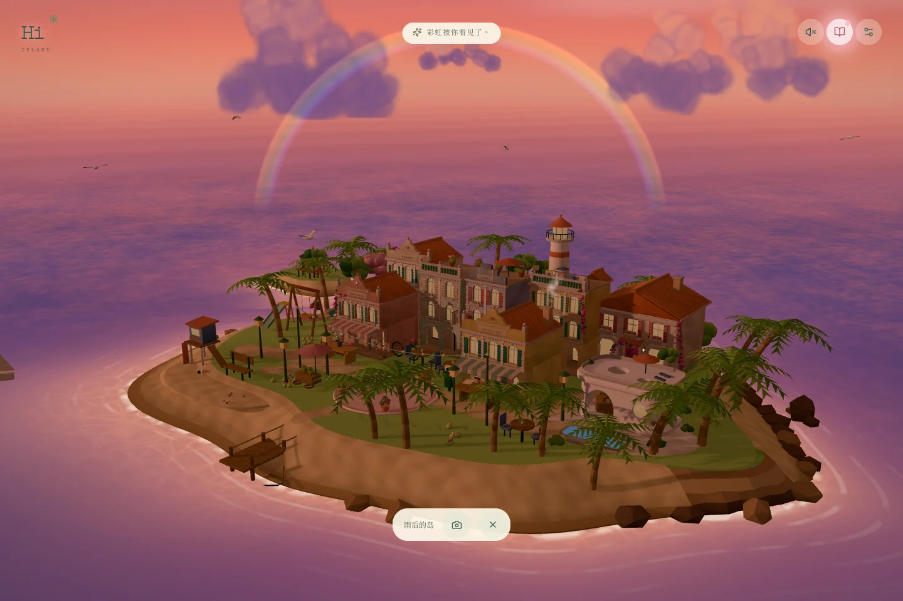

# 小岛一直在这里 · An Island for You


> 小岛一直在。想来的时候，就回来。

**[在线体验](https://island-for-you.vercel.app)** · [做一座给朋友的岛](#做一座给朋友的岛) · [English](#english)

## 它是什么

一座可以自己逛的 3D 生日小岛。点一栋房子，镜头就走过去；房子里的东西都能碰：照片墙、唱片机、床边的手机，还有一本手账。

岛上有九个地方，等着做五件小事：回家看看、包一束花、吃点好吃的、收藏一次日落、等一次天亮。五件都打上勾，岛心会摆好一张长桌：灯一盏一盏亮起来，蛋糕端上来，点蜡烛，按住许愿，吹灭。然后回家，拆一封信。

它原本是我送给一位朋友的生日礼物。这个仓库是脱敏后的公开版：照片换成了白底的鼠标涂鸦，信换成了示例，保留了原版的五首歌。原版的细节和小机关大多留着。



## 怎么玩

| 你做什么 | 发生什么 |
| --- | --- |
| 拖动、滚轮、双指 | 转着看、凑近看。没有视角按钮，镜头全靠手 |
| 点一栋房子 | 走进那个地方，能碰的东西会轻轻闪一下 |
| 打开手账 | 五件小事的清单、手绘地图、你拍的照片，还有一页按时间记下的日记 |
| 在海边坐下，走上山顶，在白房子旁边等雨停 | 顶上出现倒计时。时间到的那一刻，有东西可以接住 |
| 拿起相机 | 取景框的四条边都能拉，拉成什么形状，照片就是什么形状 |
| 随手点水面、树、花丛和沙滩 | 每次冒出来的东西都不一样 |

没有积分，也不用按顺序走。拆信以后，小岛还开着，时间可以自己调。

## 做法

- **傍晚不卡。** 最早每盏路灯是一个点光源。three.js 里灯的数量一变，全场材质都要重新编译，灯一亮，画面冻住 5 到 6 秒。现在灯的数量从头到尾固定，灯晕用发光贴图画；晚上才出现的蛋糕、彩旗和烟花，开场就建好、藏起来、提前编译。在一台 M2 MacBook Air 的 Chrome 里测（1440×900 窗口），点灯那一刻和整个傍晚都是 60 fps，最长的一帧 17 ms；手机真机未实测。
- **镜头靠手。** 每个地方都有自己的边界和阻尼（camera-controls），拖动、滚轮、双指走同一套平滑。日出那段山路是一条 Catmull-Rom 曲线：镜头走 11 秒，视线看向前方一段路，所以不晃。
- **岛上所有中文都在一份清单里。** `scripts/copy-deck.mjs` 读 TypeScript 语法树，把 389 条中文（连读屏文字也算）按逛岛的顺序导出成一份 Markdown，改完一条命令写回代码。原版的文案，我就是在这份清单里改的。
- **字体只带用得到的字。** 思源宋体、龙藏体、霞鹜文楷按页面里实际出现的字做子集（601 个和 441 个字），四个字体文件一共 372 KB。
- **房间里有声音。** 入岛、唱片机、食堂、日出与结尾沿用原版的五首歌；生日歌仍是浏览器实时合成的八音盒。原来的公有领域音乐盒生成脚本也保留，方便自行换曲。

## 做一座给朋友的岛

真正让它特别的，是每样东西为什么出现在这里。动手之前，先挑出最像你们的 5 到 12 个瞬间。

1. **名字和信**：`src/content.ts` 里的 `site` 决定岛怎么称呼 TA（默认「岛主」）、署名和左上角的字；`letter` 是那封信。
2. **照片**：按类别放进一个文件夹，再运行
   ```sh
   npm run photos -- import ~/Pictures/island
   ```
   类别是子文件夹的名字：`portrait`（TA 的照片，至少两张）、`sunset`（日落和日出，至少一张）、`together`、`food`、`flowers`、`journal`、`street`、`daily`；根目录可以放一段 `video.mp4`。照片会缩成网页尺寸，并去掉 EXIF，拍摄时间和定位不会上网。导入生成的画使用 `npm run photos -- artworks <folder>`；想换回简单占位图使用 `npm run photos -- placeholders`。当前 24 张画的生成提示词见 [docs/ARTWORK.md](docs/ARTWORK.md)。
3. **所有文案**：`node scripts/copy-deck.mjs export` 生成 `文案清单.md`，改完运行 `node scripts/copy-deck.mjs apply`。用到新字的话，重新做字体子集：`python3 scripts/prepare_fonts.py`（需要 fontTools，脚本开头有说明）。
4. **招牌**：房子上的英文招牌在 `src/world/anchors.json`。
5. **音乐**：`src/content.ts` 的 `tracks` 指向 `public/music`。只放你有权分发的音乐。

照片里出现的人、地点和聊天内容，公开之前先问过 TA。

## 本地运行

需要 Node.js 22.12+。

```sh
npm ci
npm run dev      # http://localhost:5173
npm run build
npm test
```

地址后面加 `?lite` 会关掉后期效果（帧率低于约 32 fps 时，页面也会自己切过去）。浏览器自动检查见 [docs/QA.md](docs/QA.md)。

## 素材与版权

- 字体：Noto Serif SC、Long Cang、LXGW WenKai（霞鹜文楷）、Caveat，都是 SIL Open Font License 1.1，详见 [public/fonts/LICENSES.md](public/fonts/LICENSES.md)
- 音乐：Imagine Dragons 的 Nice to Meet You、Bad Liar；Taylor Swift 的 Call It What You Want、Down Bad、Babylon。这些录音不属于本项目的 MIT 许可证；生日八音盒由浏览器合成
- 图片：imagegen 生成的 24 张白底鼠标涂鸦；公开素材不包含参考原图、人物姓名、原文件名或 EXIF
- 3D 模型：`scripts/build_island.py` 在 Blender 4.5 里生成，没有下载任何模型
- Draco 解码器（`public/draco`）：Google，Apache-2.0

## 边界

这个版本包含可运行的源码、生成的涂鸦、示例信和五首歌曲。原版里的真实照片、录像、私人信、名字和地名不包含在公开素材与 git 历史里。

## English

An explorable 3D birthday island. Tap a house and the camera walks you in; drag, scroll or pinch to look around. Five small things (go home, wrap a bouquet, order a meal, keep a sunset, wait for the sunrise) set a long table in the square: lamps, a cake, candles, a wish you hold down, and a letter waiting at home.

I made it as a birthday gift for a friend. This public edition keeps the mechanics and replaces personal photos with 24 deliberately clumsy white-background mouse drawings, uses a sample letter, and retains the original five songs. Reference photos and their metadata are not included.

Under the hood: React Three Fiber with a fixed light budget, so nightfall never recompiles shaders; a copy deck that exports all 389 lines of Chinese text to one Markdown file and writes edits back; font subsets that carry only the characters on the page. To make your own, put photos in category folders, run `npm run photos -- import <folder>`, and edit `site` and `letter` in `src/content.ts`.

**[Live demo](https://island-for-you.vercel.app)**

## License

代码使用 MIT 许可证（见 [LICENSE](LICENSE)），字体按各自的 OFL 许可证分发。歌曲录音不适用代码许可证。
