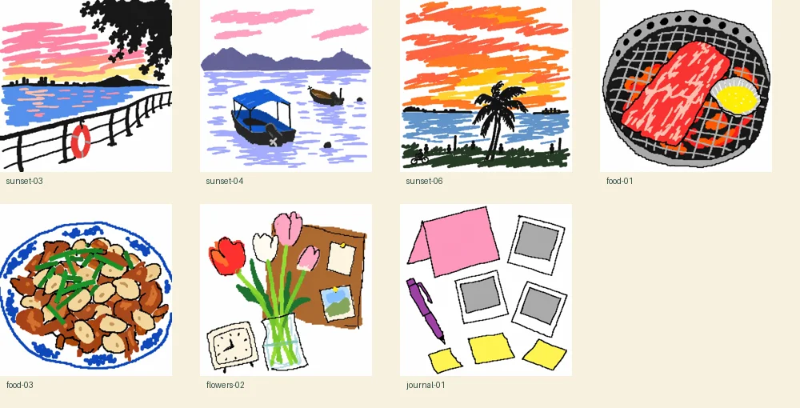

# 白底鼠标涂鸦

24 张图片由内置 imagegen 逐张生成，供照片墙、明信片、桌面和晚宴共用。原始参考照片只留在本机，未包含在公开素材中；文件使用稳定的类别编号，没有真实姓名、地点或拍摄日期。手账小物是无人物的通用静物。生成的画也不作为真实事件的记录。



方向：白底、大色块、歪线条、粗像素边缘，像用老式画图程序和鼠标仓促画出来。保留大致构图与衣服颜色，五官用极简小点代替，去掉原图里的字、水印和标识。刻意粗糙，不做成精致的复古像素插画。

完整英文提示词见 [artwork-prompts.json](artwork-prompts.json)，不含私人参考路径。生成的 PNG 源文件放在本机忽略的 `output/imagegen/`；网站只使用去掉 EXIF 的 WebP 展示图与缩略图。

如需替换，把生成结果放在分类文件夹（portrait、together、sunset、food、flowers、journal、street、daily），再运行：

```sh
npm run photos -- artworks output/my-drawings
```

导入顺序按文件名排列，维持 `portrait-01` 等编号即可保留既有手账关联。`assets-manifest.json` 的 `artwork` 字段记录生成方式；日期和地点没有推测填写。这个命令不会导入视频。
